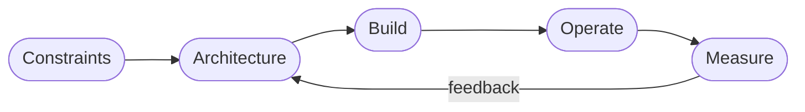

<!--
  ──────────────────────────────────────────────────────────────
  Suliaman Ibrahim · GitHub profile README
  ──────────────────────────────────────────────────────────────
  • Repo must be named  Suleyman-Tech/Suleyman-Tech  to render on
    github.com/Suleyman-Tech.
  • All visuals are best-in-class, actively-maintained services
    (capsule-render, readme-typing-svg, streak-stats, activity-graph,
    Shields.io + Simple Icons) themed to one palette:
        bg 0E0E11 · pill 17171D · accent E86A4E · text C9C8C1 / F6F5F1
    Nothing is committed to the repo, so there is nothing to build
    and no image can go stale.
  • Optional upgrade — the classic github-readme-stats card is left
    out on purpose (its public instance rate-limits / 503s). To add
    it reliably, self-host it (one-click Vercel deploy) and drop the
    card into the Analytics section pointing at your own instance.
  ──────────────────────────────────────────────────────────────
-->

 

&nbsp;
&nbsp;
&nbsp;

  

&nbsp;

---

## About

I am a software engineer, researcher, and the founder of **[Avelqor](https://avelqor.com)** — a software-engineering company that builds custom platforms, enterprise systems, and modern web products for businesses.

I design and build **production-grade systems**: long-lived software architecture, scalable services, self-hosted infrastructure, and the developer tooling around them. My interest is longevity — systems that stay maintainable, extensible, and understandable as they grow. I would rather ship an architecture a business can **own** for years than a solution it has to replace in months.

> **Software as infrastructure. Simplicity as a discipline.**

---

## Tech Stack

&nbsp;

&nbsp;

&nbsp;

&nbsp;

&nbsp;

&nbsp;

---

## GitHub Analytics

---

## Operating Model

Constraints first. Architecture before implementation. Measurement always.

| Principle | In practice |
| :-- | :-- |
| **Systems, not hacks** | Design the seams before writing the parts. |
| **Simplicity scales** | Remove before you add; the best code is deleted code. |
| **Readability is maintainability** | Optimise for the engineer reading this in two years. |
| **Ownership over convenience** | Build what a business can hold, not rent. |

---

## Selected Work

**Avelqor** — Software-engineering company: enterprise & custom development, scalable architecture, multilingual platforms, automation, and AI products. → [avelqor.com](https://avelqor.com)  
    

**Bayzo** — Marketplace-infrastructure platform: structured discovery, taxonomy, search, lead generation, and programmatic SEO.  
   

**MyOS** — AI-powered operating system for personal and business management: finance, CRM, projects, invoices, analytics, and automation.  
   

**Athena** — Premium Discord radio bot: persistent playback, scheduling, playlists, and high-quality listening.  
   

**Avelqor Tools** — A growing suite of free online tools for developers, businesses, and SEO.  
  

Selected repositories are pinned below.

---

## Connect

**[avelqor.com](https://avelqor.com)** · [founder@avelqor.com](mailto:founder@avelqor.com) · [@Suleyman-Tech](https://github.com/Suleyman-Tech) · Discord `@n9.8`

